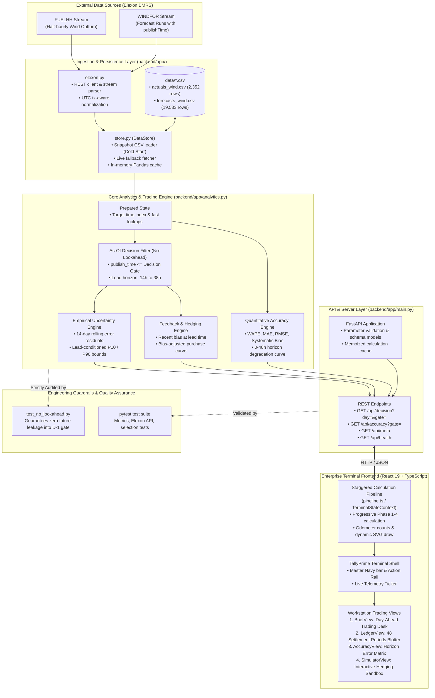

# Architecture and design notes

Written for technical review. The README covers setup and the method table.

## Shape of the system

One deployable unit. In Docker and on Heroku, FastAPI serves both `/api/*` and the built React app.
On Vercel the React build is served statically and `api/index.py` wraps the same FastAPI app as a
serverless function.

## Why these choices

**Snapshot first, live fetch as fallback.** January 2026 is historical, so the data does not change.
Committing a CSV snapshot makes deploys reproducible, cold starts fast, and the app independent of
Elexon uptime. `store.py` still fetches live when no snapshot exists, so a fresh clone works without
the extra step.

**Pandas in memory, no database.** The study window is roughly 2,500 outturn rows and a few tens of
thousands of forecast rows. Everything fits in memory and the full month accuracy report computes in
about a second. A database would add moving parts without benefit at this size. If the scope grew to
years of data or many sites, I would move ingestion to a scheduled job writing Parquet or Postgres and
keep `analytics.py` unchanged.

**`merge_asof` for forecast selection.** "Latest forecast published at or before a cutoff, per target"
is an as-of join grouped by target time. `latest_forecasts()` handles both cases with one function:
a fixed cutoff (gate closure) for the decision view, and per-target cutoffs (`T − h`) for horizon
analysis.

**Uncertainty from history known at decision time.** The likely range uses empirical error quantiles
from the previous 14 days, at similar lead times, filtered to forecasts published and outturn known
before gate closure. This avoids two common mistakes: assuming normal errors, and quietly using the
month being evaluated to build the band that is then evaluated.

**Bias adjustment from the same history.** The accuracy analysis on real data showed the forecast
running about 1.7 GW high, consistently. The cheapest way to act on that is to subtract the mean error
seen at the same lead time over the previous 14 days (`bias_at_lead` in `band_for_leads()`). It uses the
same backward-looking history as the likely range, so it carries the same no-lookahead guarantee, and
`accuracy_report()` scores it over January so its value is measured rather than claimed.

**Caching.** `analytics.prepare()` builds cleaned frames and the joined error table once per dataset.
Results for each (view, parameters) pair are memoised. Both caches are keyed by dataset identity, so
injecting a new dataset (tests) invalidates them.

## Correctness guarantees and tests

| Test file | What it protects |
| --- | --- |
| `test_selection.py` | Horizon selection on a hand-built example, boundary at exactly *h* hours, the 48 h cap, dropping post-target "forecasts" |
| `test_no_lookahead.py` | Every forecast used is published before gate closure; scrambling all post-gate data leaves the forecast, range and bias-adjusted values unchanged; the 80% band is roughly calibrated; bias adjustment reduces error on biased data |
| `test_metrics.py` | MAE, RMSE, bias, nMAE against known values; time-step detection |
| `test_elexon.py` | Payload normalisation, WIND filter, de-duplication, list vs wrapped payloads, date chunking |
| `test_store.py` | Cold start fetches then caches; second start reads the snapshot; request ranges cover the study window |
| `test_api.py` | Each endpoint's shape and input validation |

Tests run on a synthetic dataset (`tests/synthetic.py`) with the same schema as the Elexon feeds and
errors that grow with lead time. If synthetic data is ever loaded by the app, a red banner says so.

## Key development practices

- Business assumptions live in `config.py` (gate time, windows, quantiles), not scattered in code.
- Analytics are pure functions of a `Dataset`, so they are testable without HTTP.
- Typed API boundary: `frontend/src/types.ts` mirrors the backend responses.
- Split of work between server and client: the backend owns everything that needs history and the
  no-lookahead rule (forecast selection, range, bias, accuracy). The client owns everything driven by
  the trader's own inputs (risk, demand, prices, edits) in `calc.ts`, so sliders recalculate with no
  round trip. `calc.ts` is pure and unit-tested; React components only display its output.
- One state container (`TerminalStateContext`) holds selections, parameters, edits and routing, so
  every view and the hotkey handler read the same state.
- Calculation pipeline: the context separates what the user has selected (day, gate) from what has
  been committed for calculation. Committing loads the decision, then `pipeline.ts` schedules the
  reveal steps (`initializing` → `computing_metrics` → `drawing_charts` → `populating_table` →
  `ready`). Views decide what to show from that status. The staging has a minimum duration for
  readability and can be switched to Instant; a slow fetch eats into it rather than adding to it.
  Status text describes real steps and the READY line reports measured timings and a runtime
  no-lookahead check, so the UI never claims work it did not do.
- All times are UTC internally and in the API; the UI converts to UK time with `Intl` (GMT/BST safe).
- CI runs backend tests, frontend tests and build, and the Docker build on every push.

## Known limitations and next steps

- National wind only, as scoped. Solar and embedded generation are out of scope.
- Demand is a single flat figure typed by the user. The next step is to plug in the client's own
  demand forecast so the "left to buy" figure is hourly and real.
- The likely range and bias adjustment are additive (they do not scale with forecast level) and treat
  hours independently. A natural improvement is quantile regression on lead time and forecast level.
- The 14-day bias window reacts with a lag when the bias changes. A shorter or weighted window is a
  tuning choice to test against more months of data.
- Forecast and outturn are joined on `startTime`. If WINDFOR is hourly and outturn half-hourly, each
  hourly forecast is compared with the half-hour starting on the hour.
- No authentication; it is a pilot on public data.
- Prices, penalties and capacity in the terminal are user assumptions, not market data. A real
  deployment would pull day-ahead and imbalance prices from the same Elexon API.
